

<a href="https://www.siimsek.com">
  
</a>

 

 

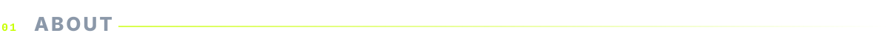


 

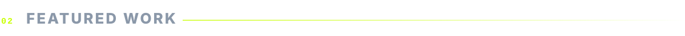

  <a href="https://www.siimsek.com"></a>
  <a href="https://github.com/siimsek/PDU"></a>

  <a href="https://github.com/siimsek/OLEDesign"></a>
  <a href="https://github.com/siimsek/Codelly"></a>

  <a href="https://github.com/siimsek/ROBOCelebi"></a>
  <a href="https://github.com/siimsek/Lightning-Kernel"></a>

 

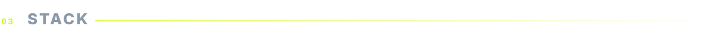

<b>⚡ HARDWARE · EMBEDDED · ROBOTICS</b>  

  

<b>🧠 SOFTWARE · AI · TOOLING</b>  

  

 

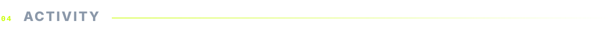

  

<picture>
  <source media="(prefers-color-scheme: dark)" srcset="https://raw.githubusercontent.com/siimsek/siimsek/output/snake-dark.svg" />
  <source media="(prefers-color-scheme: light)" srcset="https://raw.githubusercontent.com/siimsek/siimsek/output/snake-light.svg" />
  
</picture>

 

