<picture>
  <source media="(prefers-color-scheme: dark)" srcset="assets/header-dark.svg" />
  
</picture>

I'm a final-year Electrical & Electronics Engineering student at Akdeniz University, working on power electronics, PCB design and embedded systems — connecting hardware with software and industrial automation.

Captain of the TEKNOFEST 2026 finalist unmanned surface vehicle team · coordinating 23 engineering projects.

[siimsek.com](https://www.siimsek.com) &nbsp;·&nbsp; [LinkedIn](https://www.linkedin.com/in/siimsek/) &nbsp;·&nbsp; [malisimsek17@gmail.com](mailto:malisimsek17@gmail.com)

 

### Selected work

**[Modular PDU](https://github.com/siimsek/PDU)** — 6S (20–26 V) → 11 V · 7.5 A buck converter, LTspice-verified at ≈96% efficiency  
**Unmanned Surface Vehicle** — TEKNOFEST 2026 finalist; Pixhawk, ROS 2 and MAVLink autonomy, tested on water  
**[OLEDesign](https://github.com/siimsek/OLEDesign)** — pixel OLED/LCD design studio with live C codegen  
**[Codelly](https://github.com/siimsek/Codelly)** — compile and run code in 19 languages from Node.js

### Experience

`2026` &nbsp; Electronics R&D Intern — **Crystal Endüstriyel**  
`2025 →` &nbsp; Founding Member & Vice President — **Project & Engineering Society**

### Toolbox

`KiCad` `LTspice` `Power Electronics` `Delta PLC` `Pixhawk` `ArduPilot` `ROS 2` `MAVLink` `Raspberry Pi` `ESP32` `NVIDIA Jetson` `Python` `C/C++` `Git` `Linux`

 

<picture>
  <source media="(prefers-color-scheme: dark)" srcset="assets/footer-dark.svg" />
  
</picture>
