 

 

### 👋 About me

I'm a final-year **Electrical & Electronics Engineering** student at Akdeniz University, working on power electronics, PCB design and embedded systems — connecting hardware with software and industrial automation.

- 🚤 Captain of the **TEKNOFEST 2026 finalist** unmanned surface vehicle team — built most of its electronics and software
- 🛠️ Founding Vice President of the Project & Engineering Society — coordinating **23 engineering projects**
- 🏭 Electronics R&D Intern at **Crystal Endüstriyel** — Delta PLC, HMI and KiCad PCB prototyping
- 📍 Antalya, Türkiye &nbsp;·&nbsp; 🟢 Open to opportunities

 

### 🚀 Selected work

<table>
<tr>
<td width="50%" valign="top">

**⚡ [Modular Power Distribution Unit](https://github.com/siimsek/PDU)** 
Senior design · Power electronics

6S battery (20–26 V) → **11 V · 7.5 A · 82.5 W** asynchronous buck converter. Verified in LTspice and Python: 55.7 mV ripple, ≈96% efficiency.

`KiCad` `LTspice` `Python`

</td>
<td width="50%" valign="top">

**🚤 Unmanned Surface Vehicle** 
TEKNOFEST 2026 · Finalist

Led electronics and software integration: Pixhawk/ArduPilot with Raspberry Pi mission control over ROS 2 and MAVLink; GNSS, IMU, LiDAR and vision.

`ArduPilot` `ROS 2` `MAVLink`

</td>
</tr>
</table>

 

### 🧰 Tech stack

  

<b>KiCad</b> · <b>LTspice</b> · <b>Delta PLC / HMI</b> · <b>Pixhawk · ArduPilot</b> · <b>MAVLink</b> · <b>ESP32</b> · <b>NVIDIA Jetson</b> · <b>LoRa</b>

 

### 📈 GitHub activity

<picture>
  <source media="(prefers-color-scheme: dark)" srcset="https://streak-stats.demolab.com?user=siimsek&hide_border=true&background=00000000&ring=58A6FF&fire=58A6FF&currStreakLabel=58A6FF&currStreakNum=F0F6FC&sideNums=F0F6FC&sideLabels=9198A1&dates=9198A1&stroke=30363D" />
  
</picture>

  

<picture>
  <source media="(prefers-color-scheme: dark)" srcset="https://raw.githubusercontent.com/siimsek/siimsek/output/snake-dark.svg" />
  
</picture>

