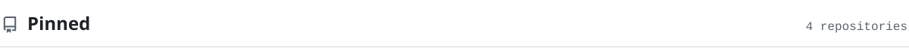
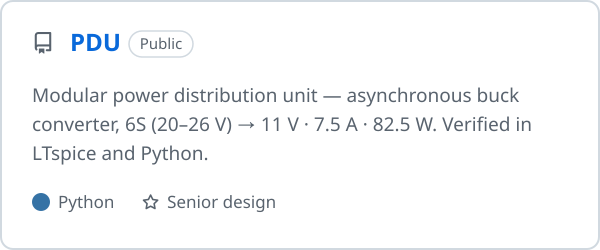
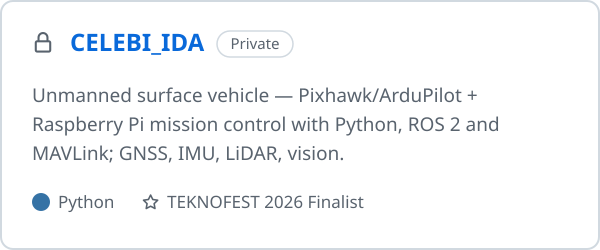
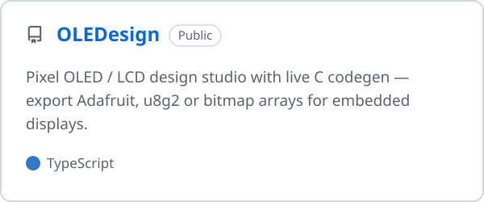
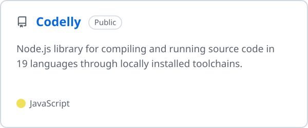
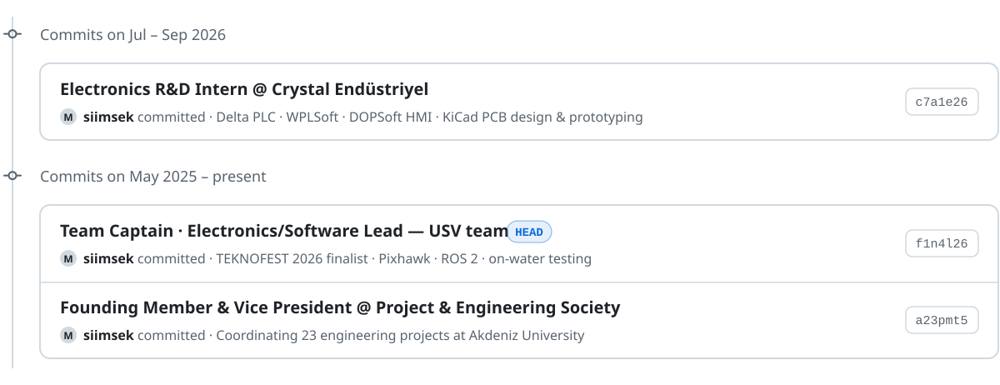
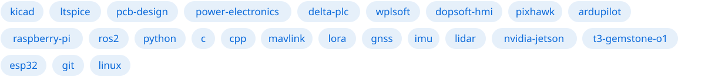
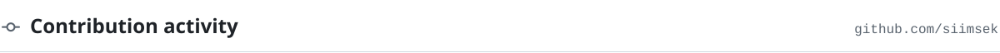

<picture><source media="(prefers-color-scheme: dark)" srcset="assets/hero-dark.svg" /></picture>

<a href="mailto:malisimsek17@gmail.com"><picture><source media="(prefers-color-scheme: dark)" srcset="assets/btn-mail-dark.svg" /></picture></a>&nbsp;
<a href="https://www.siimsek.com"><picture><source media="(prefers-color-scheme: dark)" srcset="assets/btn-site-dark.svg" /></picture></a>&nbsp;
<a href="https://www.linkedin.com/in/siimsek/"><picture><source media="(prefers-color-scheme: dark)" srcset="assets/btn-linkedin-dark.svg" /></picture></a>

<br />

```yaml
name: Muhammed Ali Şimşek
role: Electronics R&D · Power Electronics · Embedded Systems
education: Electrical & Electronics Engineering @ Akdeniz University (final year)
location: Antalya, Türkiye
status: open to opportunities   # internships · projects · collaboration

focus: [power electronics, pcb design, embedded systems, industrial automation]
highlights:
  - Team captain of the TEKNOFEST 2026 finalist Unmanned Surface Vehicle team
  - Built most of the USV's electronics and software subsystems
  - Coordinating 23 engineering projects @ Project & Engineering Society
languages: { turkish: native, english: B1, german: A2 }
```

<br />

<picture><source media="(prefers-color-scheme: dark)" srcset="assets/sec-pinned-dark.svg" /></picture>

<a href="https://github.com/siimsek/PDU"><picture><source media="(prefers-color-scheme: dark)" srcset="assets/pin-pdu-dark.svg" /></picture></a>
<a href="https://www.siimsek.com"><picture><source media="(prefers-color-scheme: dark)" srcset="assets/pin-usv-dark.svg" /></picture></a>
<a href="https://github.com/siimsek/OLEDesign"><picture><source media="(prefers-color-scheme: dark)" srcset="assets/pin-oledesign-dark.svg" /></picture></a>
<a href="https://github.com/siimsek/Codelly"><picture><source media="(prefers-color-scheme: dark)" srcset="assets/pin-codelly-dark.svg" /></picture></a>

<br />

<picture><source media="(prefers-color-scheme: dark)" srcset="assets/sec-history-dark.svg" /></picture>

<picture><source media="(prefers-color-scheme: dark)" srcset="assets/commits-dark.svg" /></picture>

<br />

<picture><source media="(prefers-color-scheme: dark)" srcset="assets/sec-topics-dark.svg" /></picture>

<picture><source media="(prefers-color-scheme: dark)" srcset="assets/topics-dark.svg" /></picture>

<br />

<picture><source media="(prefers-color-scheme: dark)" srcset="assets/sec-activity-dark.svg" /></picture>

<p align="center">
<picture><source media="(prefers-color-scheme: dark)" srcset="https://streak-stats.demolab.com?user=siimsek&hide_border=true&background=00000000&date_format=M%20j%5B%2C%20Y%5D&ring=3FB950&fire=3FB950&currStreakLabel=3FB950&currStreakNum=F0F6FC&sideNums=F0F6FC&sideLabels=9198A1&dates=9198A1&stroke=3D444D" /></picture>
</p>

<picture>
  <source media="(prefers-color-scheme: dark)" srcset="https://raw.githubusercontent.com/siimsek/siimsek/output/snake-dark.svg" />
  
</picture>

