<a href="https://www.siimsek.com">
<picture>
  <source media="(prefers-color-scheme: dark)" srcset="assets/hero-dark.svg" />
  
</picture>
</a>

<a href="mailto:malisimsek17@gmail.com"><picture><source media="(prefers-color-scheme: dark)" srcset="assets/btn-email-dark.svg" /></picture></a>&nbsp;&nbsp;<a href="https://www.siimsek.com"><picture><source media="(prefers-color-scheme: dark)" srcset="assets/btn-site-dark.svg" /></picture></a>&nbsp;&nbsp;<a href="https://www.linkedin.com/in/siimsek/"><picture><source media="(prefers-color-scheme: dark)" srcset="assets/btn-linkedin-dark.svg" /></picture></a>

  

<picture>
  <source media="(prefers-color-scheme: dark)" srcset="assets/about-dark.svg" />
  
</picture>

  

<picture>
  <source media="(prefers-color-scheme: dark)" srcset="assets/projects-dark.svg" />
  
</picture>

<a href="https://github.com/siimsek/PDU">
<picture>
  <source media="(prefers-color-scheme: dark)" srcset="assets/card-pdu-dark.svg" />
  
</picture>
</a>
<a href="https://www.siimsek.com">
<picture>
  <source media="(prefers-color-scheme: dark)" srcset="assets/card-usv-dark.svg" />
  
</picture>
</a>

Also on GitHub &nbsp;·&nbsp; <a href="https://github.com/siimsek/OLEDesign">OLEDesign</a> &nbsp;·&nbsp; <a href="https://github.com/siimsek/Codelly">Codelly</a> &nbsp;·&nbsp; <a href="https://github.com/siimsek/ROBOCelebi">ROBOÇELEBİ</a>

 

<picture>
  <source media="(prefers-color-scheme: dark)" srcset="assets/experience-dark.svg" />
  
</picture>

  

<picture>
  <source media="(prefers-color-scheme: dark)" srcset="assets/skills-dark.svg" />
  
</picture>

  

<picture>
  <source media="(prefers-color-scheme: dark)" srcset="assets/contact-dark.svg" />
  
</picture>

<a href="mailto:malisimsek17@gmail.com"><picture><source media="(prefers-color-scheme: dark)" srcset="assets/btn-email-dark.svg" /></picture></a>

  
Akdeniz University · EEE &nbsp;—&nbsp; Antalya, Türkiye

